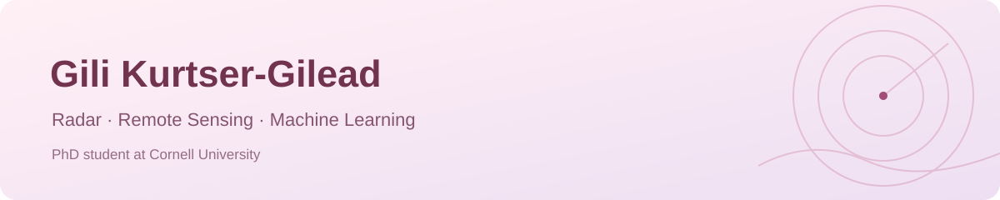

  

## Hi, I'm Gili 🌸

I'm a PhD student in Earth & Atmospheric Sciences at Cornell University, working on radar remote sensing and automated ice-layer tracing.

My background spans physics, oceanography, and data science, with experience applying machine learning to environmental and biomedical data.

## Research interests

Radar and satellite remote sensing · Signal and image processing · Computer vision · Environmental and biomedical machine learning

## Projects

[SAR assignment](https://github.com/gilikurts/SAR-assignment) — Coursework in synthetic aperture radar.

[Image processing course](https://github.com/gilikurts/image_processing_course) — Image processing coursework and code.

## Beyond research

I create science content in Hebrew about satellites, measurement technologies, and how we observe our planet.

[Instagram · @gilik.climate.science](https://www.instagram.com/gilik.climate.science/)
