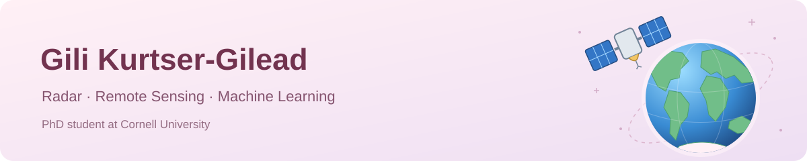

  

## Hi, I'm Gili 🌸

I'm a PhD student in Earth & Atmospheric Sciences at Cornell University, working on radar remote sensing and automated ice-layer tracing.

My background spans physics, oceanography, and data science, with experience applying machine learning to environmental and biomedical data.

## Research interests

Radar and satellite remote sensing · Signal and image processing · Computer vision · Environmental and biomedical machine learning

## Selected Publications

[Google Scholar](https://scholar.google.com/citations?user=qixhWyUAAAAJ&hl=en)

Atia, O., Kurtser, G., Focht, G., et al. (2026). [Automated readings of imaging reports by natural language processing (NLP) supplemented by clinical data predict disease course in children and adults with Crohn's disease: Report from the epi-IIRN](https://doi.org/10.1080/00365521.2026.2709610). Scandinavian Journal of Gastroenterology. Accepted / in press.

Haspel, C., Kurtser, G., & Yair, Y. (2022). [The feasibility of a 3D time-dependent model for predicting the area of possible sprite inception in the mesosphere based on an analytical solution to Poisson's equation](https://doi.org/10.1016/j.jastp.2022.105853). Journal of Atmospheric and Solar-Terrestrial Physics, 230, 105853.

## Selected Talks

IEEE IGARSS · Brisbane, 2025 — Oral presentation on the feasibility of passive satellite remote sensing of ocean microplastics using high-resolution multiple-scattering simulations.

Optica Sensing Congress · Long Beach, 2025 — Invited panel presentation on passive satellite remote sensing of ocean microplastics.

ECCO Congress · Stockholm, 2026 — Digital oral presentation: Usage of Radiomics and Graph Neural Networks for Predicting Surgical Outcomes in Crohn's Disease.

## Science Communication & Media

[Ynet / Zavit · Research feature, 2025](https://www.ynet.co.il/environment-science/article/r1yk9r45je) — Coverage of my research on passive satellite detection of ocean microplastics (in Hebrew).

I create science content in Hebrew about satellites, measurement technologies, and how we observe our planet.

[Instagram · @gilik.climate.science](https://www.instagram.com/gilik.climate.science/)
